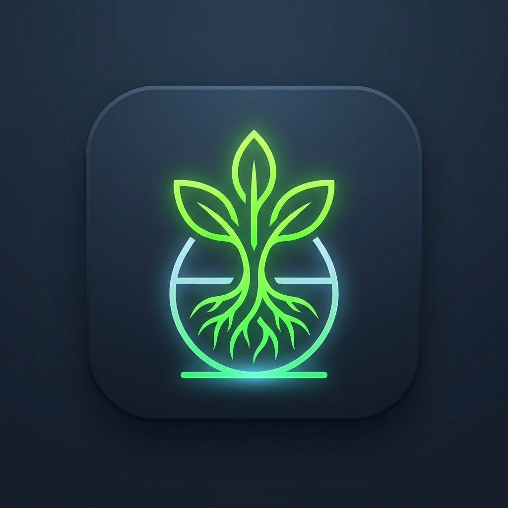
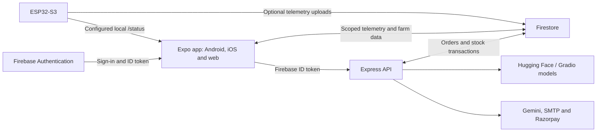
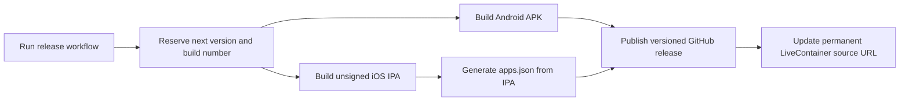

<p align="center">
  
</p>

# HyGrow Software

**Your grow system, farm inventory, and plant tools in one app.**

The software component of [HyGrow](https://github.com/Vaibhavsh0120/HyGrow): an
Android/iOS/web app built with **Expo SDK 57 and React Native 0.86**, an
authenticated **Express API**, and Firebase-backed account and farm data.

[Mobile releases](https://github.com/Keys-3/HyGrow_Software/releases)
· [LiveContainer source](https://github.com/Keys-3/HyGrow_Software/releases/latest/download/apps.json)
· [Local setup](#run-locally)
· [Architecture](#system-architecture)

[](https://github.com/Keys-3/HyGrow_Software/actions/workflows/verify.yml)

## What is included

| Feature | Behavior |
| --- | --- |
| **Monitoring and analytics** | Selected-device readings, freshness and sensor-health indicators, simulation labels, and charts of session observations. |
| **Farm management** | Inventory, marketplace listings, orders, and account settings. |
| **Plant insights** | Leaf disease classification, growth inference, and AI chat through configured backend providers. |
| **Checkout and contact** | Server-validated orders, configured Razorpay payments, and seller/support email. |

## System architecture



Fresh configured local readings take priority; authenticated cloud readings are
the fallback. Sensitive API routes validate Firebase ID tokens, and provider
secrets stay on the server. Missing readings remain unavailable. Physical actuator
control and automatic UDP discovery are not implemented in the app.

## Run locally

Requires **Node.js 22 LTS (22.13+)**. Run these commands in this folder:

```powershell
npm run install-all
npm start
```

| Service | Where to open it |
| --- | --- |
| Web app | Address printed by Expo |
| API | `http://localhost:3000` |

Stop with **Ctrl+C**. Next time, run only `npm start`.

## First-time setup

Keep existing `.env` files. If they are missing, copy the examples:

```powershell
if (!(Test-Path FrontEnd/.env)) { Copy-Item FrontEnd/.env.example FrontEnd/.env }
if (!(Test-Path BackEnd/.env)) { Copy-Item BackEnd/.env.example BackEnd/.env }
```

| File | Configure |
| --- | --- |
| `FrontEnd/.env` | `EXPO_PUBLIC_BACKEND_URL` and `EXPO_PUBLIC_DEVICE_ID` |
| `BackEnd/.env` | Firebase service credentials and the AI/email/payment keys you use |

See [backend setup](BackEnd/README.md) for service settings. Firebase CLI login
alone does not provide backend Application Default Credentials. Encrypted
`.env.age` backups require the owner's private key; keep plaintext and keys local.

### Use a phone or another computer

Set the backend URL to your computer's **LAN IP**, for example
`http://192.168.1.10:3000`. A phone's `localhost` points to the phone itself.
Both devices need reachable Wi-Fi and the computer firewall must allow port 3000.
For web access from another device, add the browser's exact origin to backend
`ALLOWED_ORIGINS`. College/guest Wi-Fi may block connections between devices.

Release builds require an explicitly configured **HTTPS** API URL. Native modules
require a **development build**; Expo Go does not contain the complete app.

## Useful commands

| Command | Purpose |
| --- | --- |
| `npm start` | Start web app and API |
| `npm run dev` | Start native Expo development and API with reload |
| `npm run clear-cache` | Restart Expo with its cache cleared |
| `npm --prefix FrontEnd run build:web` | Export the web app |
| `npm --prefix FrontEnd run typecheck` | Check TypeScript |
| `npm --prefix FrontEnd test` | Run app regression tests |
| `npm --prefix BackEnd test` | Run API regression tests |

Use `npm run install-all` after dependency changes; it installs from the
lockfiles. The separate optional Firebase Function uses **Node 24**.

## More information

- [Telemetry guide](FrontEnd/docs/TELEMETRY.md): device selection, local HTTP and sensor status.
- [Firebase access controls](FrontEnd/SECURITY.md): ownership, trusted admin claims and rule migration.
- [Backend guide](BackEnd/README.md): API endpoints and provider configuration.

## Mobile releases and LiveContainer

The manual mobile release workflow always produces an Android APK, an unsigned
iOS IPA and an `apps.json` source feed. Configure repository variables `EXPO_PUBLIC_BACKEND_URL` and
`EXPO_PUBLIC_DEVICE_ID` first. iOS builds require macOS/Xcode, and the IPA needs
signing before installation. Native builds and live Firebase rules remain
separate from local startup.

Mobile builds cache Gradle task outputs, CocoaPods and Xcode compilation. The
Android APK supports ARM64 and ARMv7 phones automatically. The first run populates
caches; later runs can reuse compiled dependencies.

In LiveContainer, open **Sources**, tap **+**, and add:
[HyGrow iOS source](https://github.com/Keys-3/HyGrow_Software/releases/latest/download/apps.json).

```text
https://github.com/Keys-3/HyGrow_Software/releases/latest/download/apps.json
```

This permanent URL becomes available when the first release completes and updates
with each release. Its version, bundle ID, minimum iOS version, file size and hash
come from the built IPA. LiveContainer installation and launch need an iPhone check.

Each manual release automatically reserves the next patch version and a higher
Android/iOS build number, builds both artifacts with those values, and publishes
the updated source at the same URL. No release inputs are required. Failed runs
keep their reserved tag so a later run never reuses that version. Release runs
are serialized to keep the latest source from being replaced by an older build.



Start [Build Mobile Releases (Unsigned)](https://github.com/Keys-3/HyGrow_Software/actions/workflows/build-release-unsigned.yml)
on `main`; no version or architecture inputs are required.
